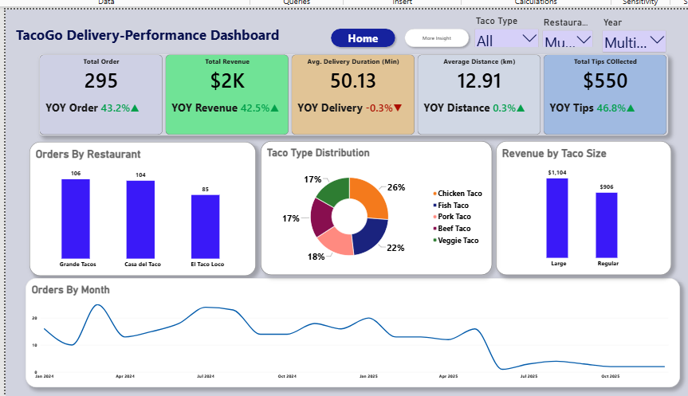
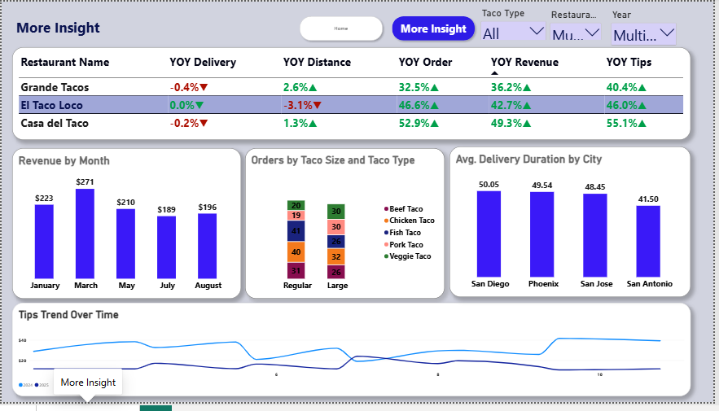

# TacoGO – Restaurant Performance & Business Analysis Report (Jan 2024 - Dec 2025) 

 

## Executive Summary

- This report presents an analysis of TacoGo's delivery performance, restaurant operations, customer orders, revenue, delivery duration, distance, and tips using a Power BI dashboard.
- The dashboard provides an overview of business performance across three restaurants: Grande Tacos, Casa del Taco, and El Taco Loco. It also examines taco type distribution, revenue by taco size, monthly order trends, and year-over-year (YOY) performance.
- The dashboard recorded 295 total orders, approximately $2K in total revenue, an average delivery duration of 50.13 minutes, an average delivery distance of 12.91 km, and $550 in total tips collected.
- The year-over-year indicators show growth in orders, revenue, and tips. However, delivery duration and distance experienced only small changes. The analysis also reveals differences in restaurant performance, customer preferences, and delivery operations across cities.

## Business Context
- TacoGo operates a food delivery business serving customers through multiple restaurants and taco varieties.
For a delivery business, understanding customer demand, restaurant performance, delivery efficiency, and revenue generation is essential. These factors help management identify areas of strength and opportunities for improvement.
- This analysis focuses on understanding how TacoGo's restaurants perform, which taco types and sizes contribute to revenue, how delivery operations vary across locations, and how business performance changes over time.

## Objectives

### The objectives of this analysis were to:

- Evaluate overall order and revenue performance.
- Compare sales and order performance across restaurants.
- Identify customer preferences by taco type and size.
- Examine monthly order and revenue trends.
- Analyse delivery duration and distance.
- Evaluate year-over-year business performance.
- Identify operational areas that may require improvement.
  
   ## Data Overview
   ### The dashboard presents business data covering the following areas:

Data Area| Description
Orders| Total orders and order growth
Revenue| Revenue performance and growth
Restaurants| Grande Tacos, Casa del Taco, El Taco Loco
Taco Types| Chicken, Fish, Pork, Beef, Veggie
Taco Sizes| Regular and Large
Delivery| Duration and distance
Tips| Total tips and trends over time
Geography| Delivery performance across cities
Time| Monthly and year-over-year comparisons

The dashboard includes a Home page for overall performance and a More Insight page for detailed comparisons.

## Dashboard

## More insight view

### Link to Power BI Report
Click the link to access the full Power BI report: [CLICK HERE](https://app.powerbi.com/view?r=eyJrIjoiMTQ4ZDQ1MWMtOGY1ZC00ZmE5LWE2YzQtN2VkNWYwOWZjZTlmIiwidCI6ImJjN2Y1MzUzLTgxZTYtNDk5My1hZjI4LTBhZGUzNWI4NzU4ZCJ9) 

## Key Findings

### The dashboard was developed to investigate:

Overall Business Performance

- Total Orders: 295
- Total Revenue: approximately $2K as displayed
- Average Delivery Duration: 50.13 minutes
- Average Delivery Distance: 12.91 km
- Total Tips Collected: $550

Year-over-Year Performance

Metric| YOY Change
Orders| +43.2%
Revenue| +42.5%
Delivery Duration| -0.3%
Distance| +0.3%
Tips| +46.8%

Orders, revenue, and tips recorded positive year-over-year growth.

Restaurant Performance

Restaurant| Orders
Grande Tacos| 106
Casa del Taco| 104
El Taco Loco| 85

Grande Tacos recorded the highest number of orders, closely followed by Casa del Taco. El Taco Loco recorded the lowest order volume among the three restaurants.

Taco Type Distribution

Taco Type| Share
Chicken Taco| 26%
Fish Taco| 22%
Pork Taco| 18%
Beef Taco| 17%
Veggie Taco| 17%

Chicken Taco had the largest share of orders, while Veggie Taco and Beef Taco recorded the smallest shares.

Revenue by Taco Size

- Large tacos generated approximately $1,104.
- Regular tacos generated approximately $996.

Large tacos contributed more revenue than regular tacos.

## Data Cleaning and Transformation

### The preparation and transformation process involve

The analysis uses business categories such as restaurant name, taco type, taco size, city, month, and year to support comparisons.

The dashboard also presents calculated performance indicators, including:

- Total orders
- Total revenue
- Average delivery duration
- Average delivery distance
- Total tips
- Year-over-year percentage changes

## Detailed Findings & Analysis

Restaurant Performance Analysis

Grande Tacos recorded 106 orders, making it the highest-performing restaurant by order volume. Casa del Taco followed closely with 104 orders, while El Taco Loco recorded 85 orders.

The More Insight page provides additional year-over-year comparisons:

Restaurant| YOY Orders| YOY Revenue| YOY Tips
Grande Tacos| +32.5%| +36.2%| +40.4%
El Taco Loco| +46.6%| +42.7%| +46.0%
Casa del Taco| +52.9%| +49.3%| +55.1%

Casa del Taco recorded the strongest growth across orders, revenue, and tips among the three restaurants.

Delivery Performance by City

City| Average Delivery Duration
San Diego| 50.05 minutes
Phoenix| 49.54 minutes
San Jose| 48.45 minutes
San Antonio| 41.50 minutes

San Antonio recorded the shortest average delivery duration among the cities displayed, while San Diego recorded the longest.

Revenue and Monthly Trends

The monthly revenue chart shows:

- January: $223
- March: $271
- May: $210
- July: $189
- August: $196

March recorded the highest revenue among the months displayed in the chart.

The monthly order trend shows fluctuations over time, with a noticeable decline during the later part of the displayed period.

Customer Tips

Total tips collected reached $550, with year-over-year tips increasing by 46.8%.

The tips trend page compares tip performance over time, providing a view of how customer tipping behaviour changes across the displayed years.

## Recommendations

Based on the dashboard findings:
- Investigate the practices contributing to Casa del Taco's strong year-over-year growth and consider applying successful strategies across other locations.
- Review El Taco Loco's lower order count and identify opportunities to increase customer demand.
- Use customer preference data to guide promotions and menu planning, particularly for Chicken Taco.
- Examine the factors contributing to longer delivery durations in San Diego and Phoenix.
- Track declining order periods and investigate possible causes of reduced demand.
- Continue monitoring tips and delivery performance as indicators of customer experience.

## Tools Used

**Microsoft Power BI:** Used to develop interactive dashboards and visualize restaurant performance.

**Power Query:** Used for data preparation and transformation.

**DAX:** Used to create calculated measures, KPIs, and year-over-year performance indicators.

## Conclusion

The TacoGo Delivery Performance Analysis provides insight into restaurant performance, customer preferences, revenue generation, and delivery operations.

The dashboard shows positive year-over-year growth in orders, revenue, and tips. Grande Tacos leads in order volume, while Casa del Taco demonstrates the strongest growth across key business indicators.

The findings provide a foundation for improving restaurant performance, monitoring delivery efficiency, and making data-driven decisions to support TacoGo's continued growth.

**Tools:** Microsoft Power BI, Power Query, DAX

**Analysis Period**: two years 

**Project Category:** Business Intelligence & Data Analytics
